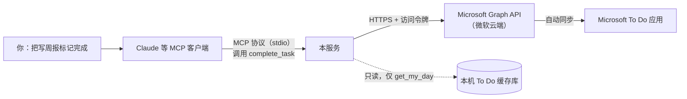

# Microsoft To Do MCP

[](LICENSE)

一个 MCP 服务，让 Claude 等 AI 客户端读写你的 Microsoft To Do。你可以直接说“今天加个任务：写周报”“把写周报标记完成”，由 AI 调用对应的工具完成。

主要特点：

- 用任务标题和列表名操作，不需要先查 id
- 个人微软账号不用注册 Azure 应用，登录一次即可
- 输出为中文，日期支持 today、明天、`HH:mm` 等写法
- 请求带超时和重试，能防止重复创建；可以开启只读或禁止删除模式

## 快速开始

需要 Node.js ≥ 20 和 Git。本项目不发布到 npm，直接从 GitHub 安装，首次运行时会自动下载并编译，所以会慢一些。

**1. 登录微软账号（只需一次）**

```bash
npx -y github:hechen-coder/microsoft-todo-mcp login
```

终端会显示一个网址和验证码。在浏览器打开网址，输入验证码，用 To Do 的账号登录。授权页面上申请权限的应用叫 “Microsoft Graph Command Line Tools”，点“接受”。之后令牌会自动续期。

**2. 接入 Claude Code**

Windows：

```bash
claude mcp add todo --scope user -- cmd /c npx -y github:hechen-coder/microsoft-todo-mcp
```

macOS / Linux：

```bash
claude mcp add todo --scope user -- npx -y github:hechen-coder/microsoft-todo-mcp
```

重启 Claude Code 会话后生效。

Claude Desktop 在 `claude_desktop_config.json` 中添加下面的配置。Windows 下把 `command` 改为 `cmd`，并在 `args` 开头加上 `"/c", "npx"`。

```json
{
  "mcpServers": {
    "todo": {
      "command": "npx",
      "args": ["-y", "github:hechen-coder/microsoft-todo-mcp"]
    }
  }
}
```

第 1 步也可以跳过：接入后让 Claude 调用 `login` 工具，它会把网址和验证码告诉你。

常用说法举例：

- “今天加两个任务：写周报、给导师发邮件”
- “把写周报标记完成”
- “今天还有哪些任务没做？”
- “把写周报的第 2 步勾掉”

## 工具列表

| 工具 | 作用 |
|---|---|
| `auth_status` / `login` | 查看登录状态 / 设备码登录 |
| `list_lists` / `create_list` | 列出 / 新建列表 |
| `list_tasks` | 列出某个列表的任务（默认“任务”列表，只看未完成） |
| `search_tasks` | 跨列表按关键字搜索 |
| `get_today_tasks` | 今天截止或已逾期的未完成任务 |
| `get_my_day` | 读取“我的一天”（仅 Windows，见下文） |
| `add_task` | 新建任务，可设截止日期、重要、备注、提醒 |
| `add_today_task` | 批量新建今天截止的任务 |
| `add_step` / `list_steps` | 添加 / 查看子步骤 |
| `update_step` | 勾选、取消勾选或改写子步骤，可用序号（如“第2步”）、文字或 id 指定 |
| `delete_step` | 删除子步骤 |
| `complete_task` / `uncomplete_task` | 勾选 / 取消勾选任务，按标题模糊匹配或 id |
| `update_task` | 修改标题、截止日期、重要性、备注、提醒 |
| `delete_task` | 永久删除任务 |

## 工作原理



1. 客户端启动本服务，本服务告诉 AI 自己提供哪些工具、需要哪些参数。
2. 你用自然语言下指令，AI 决定调用哪个工具，比如 `complete_task`。
3. 本服务用你的授权令牌调用微软官方的 Graph API，修改云端数据。
4. To Do 应用从云端同步，几秒后显示变化。

所有修改都发生在云端，而不是直接改本机应用。本机 To Do 应用没有对外接口，它的数据只是云端的同步缓存，直接改它的数据库可能和同步冲突。这也意味着，**To Do 应用要能正常同步，修改才会在应用里显示**。

### 登录和授权

任务数据存在你的微软账号下，程序读写之前要先得到你的授权。本项目使用 OAuth 设备码流程：

1. `login` 向微软申请一个设备码；
2. 你在浏览器里登录微软账号，确认授权“读写任务”；
3. 微软把访问令牌发给本程序，之后调用 API 时都带上它；
4. 令牌缓存在 `%APPDATA%\todo-mcp\msal-cache.json`（macOS / Linux 为 `~/.config/todo-mcp/`），过期后自动续期。

程序拿不到你的密码，拿到的令牌只能读写任务和读取账号基本资料。

> ⚠ `msal-cache.json` 能直接访问你的任务，不要分享或上传。退出登录：`npx -y github:hechen-coder/microsoft-todo-mcp logout`；彻底撤销授权：到 <https://account.live.com/consent/Manage> 移除 “Microsoft Graph Command Line Tools”。

### 关于“我的一天”

Graph API 不提供“我的一天”的数据，因此有两点限制：

- `add_today_task` 只能把截止日期设为今天。任务会出现在“计划内”，并作为“我的一天”的建议，但不会直接加进“我的一天”。
- `get_my_day` 通过只读方式读取本机 To Do 应用的缓存库来获得“我的一天”，所以只在安装了 To Do 应用的 Windows 上可用，并且需要 Node.js ≥ 22.5。它不会写入这个数据库。

## 常见问题

### To Do 应用一直同步失败（左上角显示橙色圆点）

如果系统代理指向本机（例如 Clash 的 `127.0.0.1:7890`），Windows 默认不允许 Microsoft Store 应用连接 127.0.0.1，To Do 就无法同步。用管理员终端执行下面的命令，然后重启 To Do：

```bash
CheckNetIsolation LoopbackExempt -a -n="Microsoft.Todos_8wekyb3d8bbwe"
```

### 使用自己的 Azure 应用，或工作 / 学校账号

注册一个 Azure 应用：账户类型包含个人帐户，开启“允许公共客户端流”，添加委托权限 `Tasks.ReadWrite` 和 `User.Read`。然后用应用的 Client ID 登录：

```bash
npx -y github:hechen-coder/microsoft-todo-mcp login <你的ClientID>
```

工作或学校账号还需要设置环境变量 `TODO_TENANT=organizations`。

## 环境变量（可选）

| 变量 | 说明 |
|---|---|
| `TODO_CLIENT_ID` | 自定义 Azure 应用的 Client ID |
| `TODO_TENANT` | 默认 `consumers`（个人账号）；工作 / 学校账号用 `organizations` 或 `common` |
| `TODO_TIMEZONE` | 截止和提醒时间使用的时区，默认取系统时区 |
| `TODO_LOCAL_DB` | 手动指定 To Do 本地缓存库 `todosqlite.db` 的路径 |
| `TODO_READONLY` | 设为 `1` 时只开放查询类工具，AI 无法修改数据 |
| `TODO_NO_DELETE` | 设为 `1` 时不开放 `delete_task` 和 `delete_step` |
| `TODO_TIMEOUT_MS` | 单次请求的超时时间，默认 15000 |
| `TODO_DEDUP_SECONDS` | 防重复创建的时间窗口，默认 60 秒 |

例如以只读方式接入：

```bash
claude mcp add todo-ro -e TODO_READONLY=1 -- cmd /c npx -y github:hechen-coder/microsoft-todo-mcp
```

## 可靠性设计

- **超时与重试**：每个请求最多等 15 秒。遇到 429、503、504 时，按服务端给的 `Retry-After` 或逐次加长的间隔重试，最多 3 次。查询、修改、删除请求在超时或断网时也会重试；新建请求不会，因为它可能已经生效，重试会建出重复任务。
- **防重复创建**：`add_task`、`add_today_task`、`add_step`、`create_list` 在 60 秒内收到参数完全相同的请求时，直接返回上次的结果。服务重启后这个记录会清空。
- **风险分级**：每个工具都标注了 MCP `annotations`（`readOnlyHint` / `destructiveHint`），客户端可以据此决定执行前是否询问你。

## 本地开发

```bash
git clone https://github.com/hechen-coder/microsoft-todo-mcp.git
cd microsoft-todo-mcp
npm install
npm run build
npm run login
claude mcp add todo-dev -- node /绝对路径/microsoft-todo-mcp/dist/cli.js
```

## 同类项目

- [fabienbutz/microsoft-todo-mcp](https://github.com/fabienbutz/microsoft-todo-mcp)
- [jordanburke/microsoft-todo-mcp-server](https://github.com/jordanburke/microsoft-todo-mcp-server)

## License

[MIT](LICENSE)
